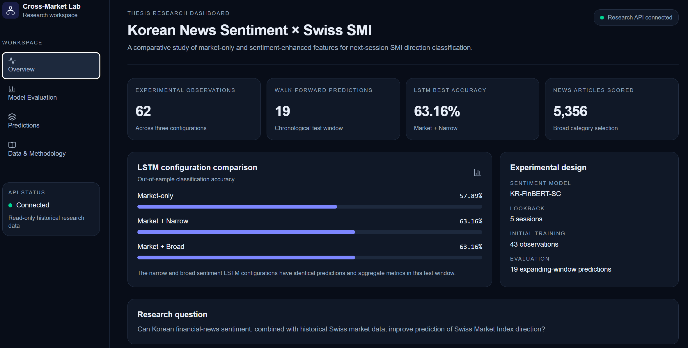
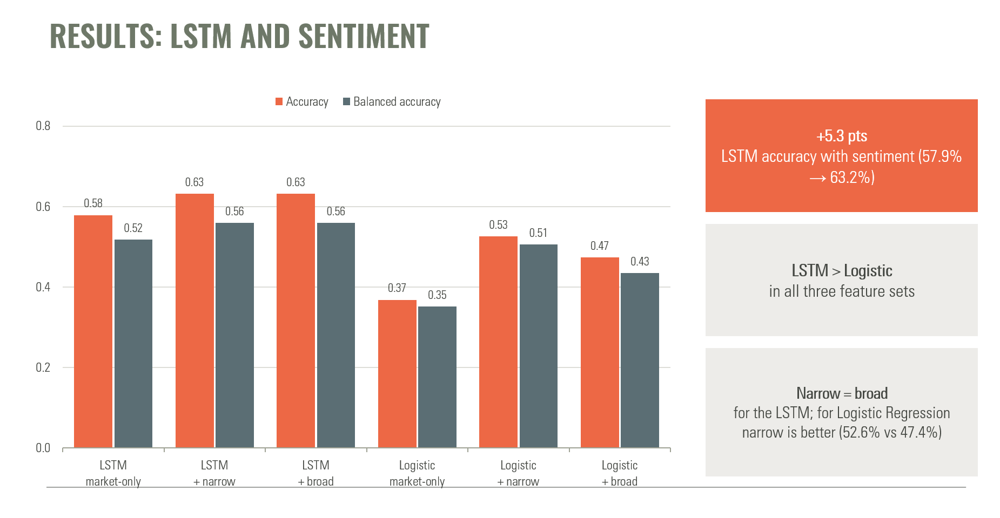

# 🇰🇷 → 🇨🇭 Can Korean News Predict Swiss Markets?

**An end-to-end ML project: 5,356 Korean financial news articles → FinBERT sentiment → LSTM → a live research dashboard.**

[](#)
[](#)
[](https://huggingface.co/snunlp/KR-FinBERT-SC)
[](#)
[](#)



> **Bachelor's thesis project** · Smart Computing · Kyungdong University

---

## The idea in 30 seconds

Markets don't move in isolation. When Seoul closes, Zurich hasn't opened yet. So I asked:

> **Does the mood of Korean financial news, published *before* the Swiss market opens, help predict whether the Swiss Market Index (SMI) goes up or down the next day?**

To find out, I built the whole thing myself: data cleaning, Korean-language NLP, time-series modelling, a strict leakage-free evaluation, and a dashboard to explore the results.

---

## What I built

| | |
|---|---|
| 📰 **5,356 articles scored** | Korean financial news run through a finance-specific BERT model (KR-FinBERT-SC) |
| 📈 **93 days of aligned data** | KOSPI + SMI prices, daily sentiment, and news volume, Jul–Oct 2026 |
| 🧠 **2 model families, 3 feature sets** | LSTM and Logistic Regression, each tested on market-only, market + narrow news, and market + broad news |
| 🔒 **Zero look-ahead bias** | News is matched only to the *next* Swiss trading session; scalers are fit on training data only |
| 🖥️ **Full-stack dashboard** | FastAPI backend + Next.js/TypeScript frontend that reads the saved results |

---

## Results




Evaluated with **expanding-window walk-forward testing** (the model is always trained only on the past, then predicts the next day).

| Model | Features | Accuracy | F1 | Balanced Acc. |
|---|---|:---:|:---:|:---:|
| LSTM | Market-only | 57.9% | 0.69 | 0.518 |
| **LSTM** | **Market + Korean news sentiment** | **63.2%** | **0.74** | **0.560** |
| Logistic Regression | Market-only | 36.8% | 0.45 | 0.351 |
| Logistic Regression | Market + Narrow news | 52.6% | 0.61 | 0.506 |

**What happened:** adding Korean news sentiment lifted the LSTM from 57.9% to 63.2% (+3 correct calls out of 19). For Logistic Regression, sentiment improved accuracy by about 16 percentage points (36.8% → 52.6%).

**The honest part:** the test window is only 19 days, and a naive "always predict up" baseline also scores 63.2%. So I treat this as an encouraging early signal, **not** proof. Reporting that plainly was a deliberate choice: in finance, a result you can't trust is worse than no result.

---

## How it works

```
Korean news (BigKinds)          KOSPI + SMI prices
        │                               │
  clean & filter by category            │
        │                               │
  KR-FinBERT-SC sentiment               │
  (positive − negative)                 │
        │                               │
  aggregate per day ──► align to NEXT Swiss session
                                │
                  three datasets: market-only / +narrow / +broad
                                │
              LSTM  &  Logistic Regression (walk-forward)
                                │
                 saved predictions + metrics (CSV)
                                │
                  FastAPI (read-only)  ──►  Next.js dashboard
```

**Key design decisions**

- **Leakage prevention.** Sentiment from day *t* is only ever attached to a Swiss session *after* day *t*. Scalers are fit on training data only, inside every fold.
- **Narrow vs. broad news.** I tested whether *focused* finance news (stocks, banking) carries a different signal than *all* economic news.
- **Fair comparison.** All three feature sets use the exact same dates, so differences come from the features, not the sample.
- **Single source of truth.** The Python pipeline produces every number; the dashboard only displays them and never recalculates.

---

## Skills this project demonstrates

- **NLP:** applying a transformer model to Korean-language text at scale
- **Time-series ML:** LSTM in PyTorch, walk-forward validation, baseline comparison
- **Data engineering:** cleaning, deduplication, category filtering, cross-timezone alignment
- **Research rigor:** leakage control, honest reporting of small-sample limits
- **Full-stack:** REST API (FastAPI) and a typed React frontend (Next.js, TypeScript, Tailwind)

---

## Run it yourself

```bash
git clone https://github.com/Wambura001/lstm-vs-finbert-algorithmic-trading.git
cd lstm-vs-finbert-algorithmic-trading
pip install -r requirements.txt
```

- Pipeline: `notebooks/02_news_sentiment_pipeline.ipynb`
- Results: `notebooks/results/`
- Dashboard (branch `feature/nextjs-dashboard`): start the API with `uvicorn api:app --port 8000`, then in `frontend/` run `npm install && npm run dev` and open http://localhost:3000

---

## Limitations

Small sample (62 observations, 19 test days), sentiment scores are model estimates rather than ground truth, and results are specific to this news source and period. This is an academic study, not a trading system or investment advice.

---
